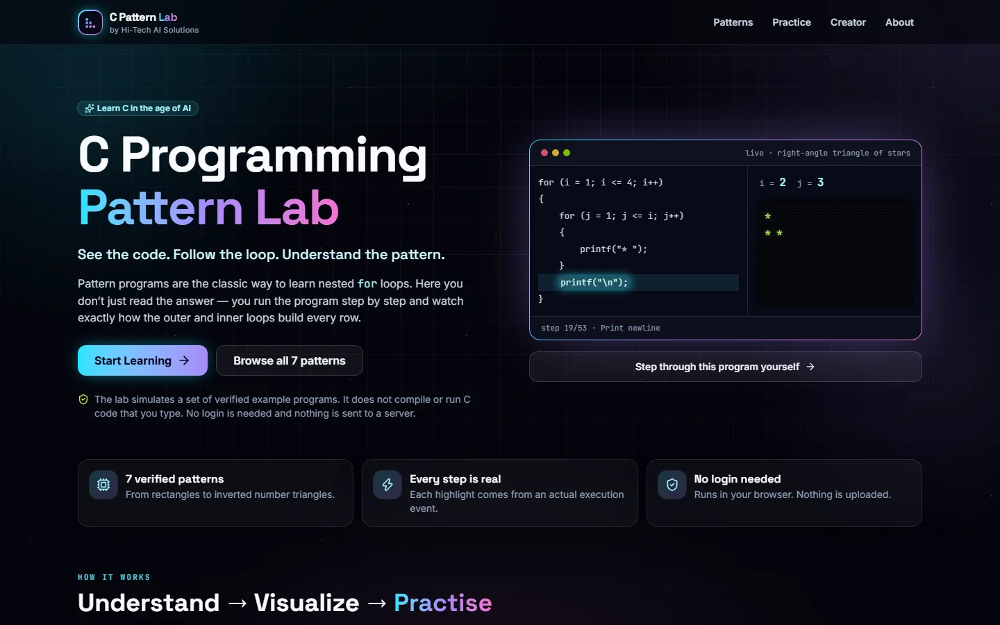
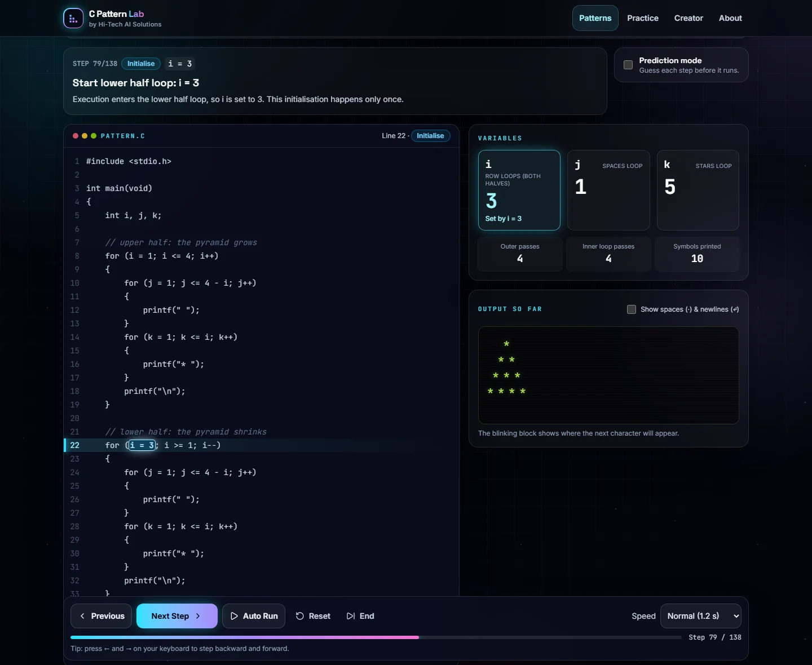
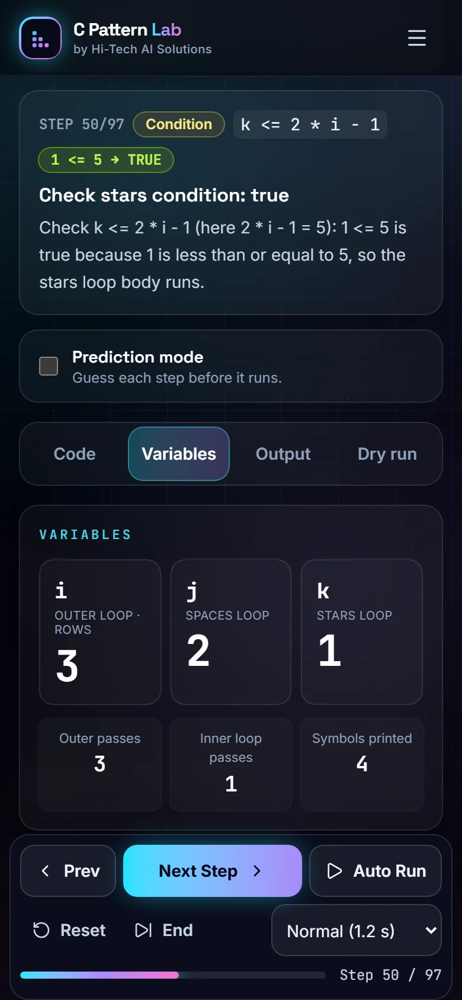
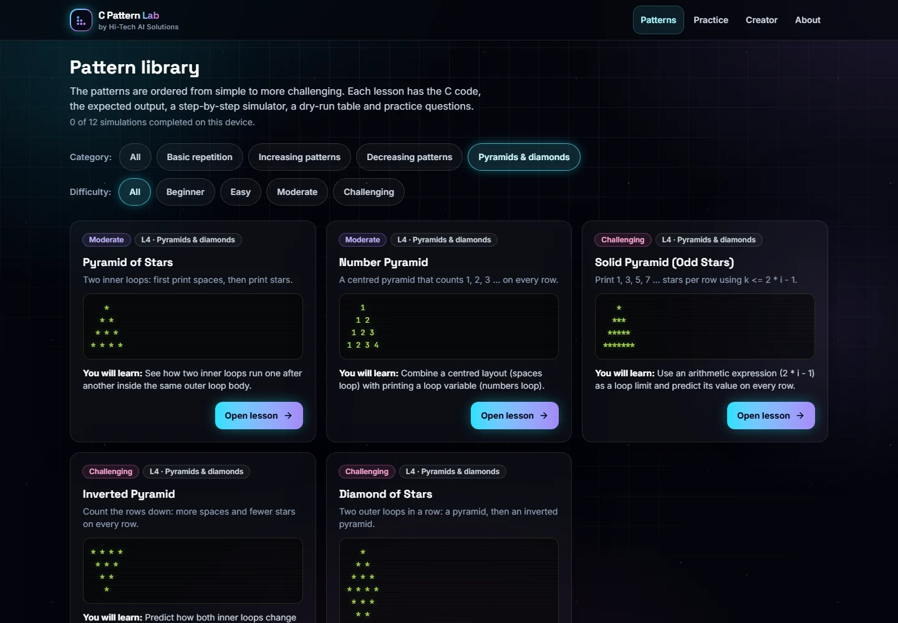

# C Programming Pattern Lab

> See the code. Follow the loop. Understand the pattern.

**▶ Live app: [c-programming-pattern-lab.vercel.app](https://c-programming-pattern-lab.vercel.app/)** · free, no login, works on phones

[](https://c-programming-pattern-lab.vercel.app/)

<table>
  <tr>
    <td width="68%"></td>
    <td width="32%"></td>
  </tr>
  <tr>
    <td align="center"><sub>Diamond: two outer loops in a row. The lower half starts at i = 3, so the widest row is printed only once</sub></td>
    <td align="center"><sub>Mobile-first: arithmetic limits worked out step by step (here 2 * i - 1 = 5)</sub></td>
  </tr>
</table>

<p align="center"><br /><sub>12 patterns across 4 levels, from rectangles to pyramids and diamonds</sub></p>

An interactive, browser-based lab that teaches **nested `for` loops** through classic C pattern programs. Students pick a pattern, read the C code, and run it **one operation at a time**. They watch the highlighted statement, the values of `i` and `j`, each condition being checked, the output growing character by character, and a dry-run table built from the same execution.

Built for first-year **BCA, BSc IT and BSc Data Science** students, and for teachers demonstrating loop execution on a projector.

**Idea, design and development:** [Hitesh Patel](https://github.com/contact2hitech): Assistant Professor and Coordinator of BSc Data Science, and Founder of [Hi-Tech AI Solutions & Services](https://hi-tech-ai-solutions.github.io/). All creator and organisation details shown in the app live in [`src/branding.ts`](src/branding.ts).

<p align="center"></p>

The full specification is in [`C_Programming_Pattern_Lab_PRD.md`](C_Programming_Pattern_Lab_PRD.md). Project status, decisions and the workflow for future changes are in [`docs/PROGRESS.md`](docs/PROGRESS.md).

---

## Features (Version 1)

- **Futuristic "space lab" design**: a dark theme with glass panels, neon highlights and an animated grid-and-glow background. All motion stops when the device asks for reduced motion. Fonts (Inter, Space Grotesk, JetBrains Mono) are bundled, so no font CDN is needed.
- **Share previews and installable app**:
  - Open Graph and X/Twitter cards give WhatsApp, Telegram, LinkedIn, Facebook and X a rich preview with a thumbnail, title and description. The image is [`public/og-image.jpg`](public/og-image.jpg): 1200×630, about 90 KB, under WhatsApp's 300 KB limit.
  - A web app manifest and icons let students "Add to Home screen".
  - Also included: JSON-LD structured data, `robots.txt` and `sitemap.xml`.
- **Home page**: the product promise, a **live terminal** that replays the real star-triangle simulation, how it works (Understand → Visualize → Practise), featured patterns, and a creator spotlight.
- **Creator page** (`/creator`): the faculty member behind the idea, the reasons for building the lab, and Hi-Tech AI Solutions & Services. "Designed & developed by" credits appear in the header and footer of every page.
- **Pattern library** with output previews, category and difficulty filters, and "completed" badges (stored on this device).
- **Lesson page** for each pattern: learning objective and goals, expected output, explanations of the outer loop, inner loop, output statement and newline, the simulator, a quiz, and previous/next navigation.
- **Simulator**
  - Code panel that highlights the exact part executing (`i = 1`, `j <= i`, `j++`, `printf("* ");` …), colour-coded *and* text-labelled.
  - Variable inspector: `i` and `j` show "not set yet" until they are initialised, plus which operation changed them (`j++: 1 → 2`). It also counts outer and inner passes.
  - Step explanation in plain English, including `2 <= 1 → FALSE` and why.
  - Output panel built event by event. Spaces and newlines are preserved, and a toggle makes them visible (`·`, `↵`).
  - Dry-run table generated from the timeline: step, operation, code, `i`, `j`, condition, result, output and explanation. The current row is highlighted and auto-scrolled, and you can click a step number to jump to it.
  - Controls: **Next Step, Previous Step, Auto Run, Pause, Reset, End (jump to end)**, four speeds and a progress bar. Keyboard shortcuts: **←** and **→**.
  - Adjustable settings (rows, columns, size), limited to safe ranges. A change rewrites the displayed C code and restarts the simulation. Settings go into the URL (`?rows=6`) so teachers can share them.
  - **Prediction mode**: before a step runs, students predict it (true or false, the next value of `j`, what gets printed). The answer always comes from the real next event.
- **Quizzes** on every lesson and in the **Practice zone** (filterable by question type). Feedback says correct or incorrect, gives a hint, allows retries and offers "reveal". Correctness is shown with icons and text, not colour alone.
- **About page** that documents the supported C subset, the step policy, limitations and privacy.
- **Mobile-first and responsive** from 320px phones up to 4K classroom displays:
  - a menu button on phones and panel tabs that stay at the top of the screen;
  - a stacked step list instead of the wide dry-run table;
  - a thumb-friendly control dock that leaves room for the phone's home indicator;
  - 44px touch targets;
  - the interface scales up on 1536px, 1920px and 2560px+ screens.

  Verified with no horizontal overflow at 320, 375, 414, 768, 1024, 1440 and 2560px.
- Keyboard accessible, screen-reader labels, and `prefers-reduced-motion` support.
- No login and no personal data. Preferences and progress live only in `localStorage`.
- **Visitor counting** (privacy-friendly, no cookies):
  - a public **live counter** on the home page and in the footer ("812 students · 3,940 visits") from one tiny serverless function, [`api/counter.ts`](api/counter.ts), that stores only two totals in Upstash Redis;
  - **Vercel Web Analytics** for the site owner's private dashboard.

  See [Visitor counter & analytics](#visitor-counter--analytics).

## Patterns

| # | Pattern | Level | Settings | Default output |
|---|---------|-------|----------|----------------|
| 1 | Rectangle of Stars | 1 · Beginner | rows 1–10, stars per row 1–10 | 3 × 4 stars |
| 2 | Square of Stars | 1 · Beginner | size 1–10 | 4 × 4 stars |
| 3 | Repeated Row Number | 1 · Easy | rows 1–9 | `1` / `2 2` / `3 3 3` / `4 4 4 4` |
| 4 | Right-Angle Triangle of Stars | 2 · Easy | rows 1–10 | 1, 2, 3, 4 stars |
| 5 | Number Triangle | 2 · Easy | rows 1–9 | `1` / `1 2` / `1 2 3` / `1 2 3 4` |
| 6 | Inverted Triangle of Stars | 3 · Moderate | rows 1–10 | 4, 3, 2, 1 stars |
| 7 | Decreasing Number Triangle | 3 · Moderate | rows 1–9 | `1 2 3 4` / `1 2 3` / `1 2` / `1` |
| 8 | Pyramid of Stars | 4 · Moderate | rows 1–10 | `   *` / `  * *` / ` * * *` / `* * * *` |
| 9 | Number Pyramid | 4 · Moderate | rows 1–9 | `   1` / `  1 2` / ` 1 2 3` / `1 2 3 4` |
| 10 | Solid Pyramid (Odd Stars) | 4 · Challenging | rows 1–10 | `   *` / `  ***` / ` *****` / `*******` |
| 11 | Inverted Pyramid | 4 · Challenging | rows 1–10 | `* * * *` / ` * * *` / `  * *` / `   *` |
| 12 | Diamond of Stars | 4 · Challenging | upper-half rows 1–9 | pyramid + inverted pyramid, 7 rows |

Patterns 1–6 are the PRD's initial library. Pattern 7 is the "decreasing number triangle" from its expansion list. Patterns 8–12 ("Pyramids & diamonds") come from the PRD's expansion candidates:
- the pyramids use **two inner loops** (spaces, then symbols) with arithmetic limits such as `j <= 4 - i` and `k <= 2 * i - 1`;
- the diamond uses **two outer loops in sequence**. The C source of the rectangle, star triangle, number triangle and inverted triangle is tested **character for character** against the PRD.

---

## How the simulator works

```
Pattern definition + parameters
        │  validateParams()        whole numbers within limits
        ▼
Structured program (for loops + printf)
        │  renderSource()          → the exact C code shown, with highlightable parts
        │  buildTimeline()         → ordered, typed events (interpreter)
        ▼
Event timeline
        │  buildStates()           → one immutable snapshot per step
        ▼
useSimulation(position)  →  every panel reads the same snapshot
```

- **No C parsing and no `eval`.** Each pattern is a small typed tree of `for` loops and `printf` calls (`src/patterns/*.ts`). The same tree is used to **render the C code** and to **run** it, so the visible code and the executed program cannot disagree.
- **Loop semantics** (`src/engine/buildTimeline.ts`): the loop variable is initialised once when entering the loop. Then: check the condition; if it is false, leave; otherwise run the body, run the update, and check again. The inner `for` is a statement inside the outer body, so `j = 1` runs again on every row.
- **Events:** `INIT_VARIABLE`, `CONDITION_CHECK`, `OUTPUT`, `NEWLINE`, `INCREMENT`, `DECREMENT`, `PROGRAM_END`. Each one carries its code part and line, the variables before and after, the condition expression with values substituted and its result, the exact text appended, its loop (outer or inner) and a plain-English explanation.
- **Step policy:** step 0 is "declared, not initialised". Every later step is one event. There is no separate "leave loop" event: a `CONDITION_CHECK` whose result is `false` is the moment the loop ends. (This is the PRD's `LOOP_TRANSITION`.) Star triangle, first row: `i = 1` → `1 <= 4 true` → `j = 1` → `1 <= 1 true` → print `"* "` → `j: 1→2` → `2 <= 1 false` → newline → `i: 1→2` → `2 <= 4 true`.
- **Previous Step** selects the earlier snapshot. Nothing is undone by hand, so the state is always exact. **Auto Run** dispatches the same "advance one event" action on a timer. The timer is cleared on pause, reset, manual stepping, a settings change, leaving the page and unmount.
- **Safety:** parameters are validated (max 10). The engine refuses to use a variable before it is initialised and stops after 5,000 events.

### Supported C subset

- **Declarations:** `int i, j;` or `int i, j, k;`
- **Loops:** nested `for` loops, with one or two inner loops per outer body, or several outer loops in sequence.
- **Initialisation:** `var = expression`.
- **Conditions:** `<=`, `<`, `>=` or `>` against an expression.
- **Expressions:** numbers, lesson settings (shown as their value), loop variables, and `+`, `-`, `*`. Parts with no variable are shown as their value, so `rows - 1` appears as `3`.
- **Updates:** `++` and `--`.
- **Printing:** `printf("* ")`, `printf("*")`, `printf(" ")`, `printf("%d ", var)` and `printf("\n")`.
- **Other:** `// comments` (shown, never executed) and `return 0;`

Each code part has a unique id, and rendering fails if two parts share one, so a highlight can never be ambiguous.

### Adding a pattern

1. Create `src/patterns/myPattern.ts` exporting a `PatternDefinition`. Build the program with `nestedLoopProgram(...)` or `pyramidProgram(...)` / `pyramidLoop(...)` from `builders.ts`, or write the `PatternProgram` tree directly. Its `explain()` cards refer to loops and statements by id, so their code is copied from the rendered program.
2. Write `expectedOutput` by hand for the default settings, including the trailing spaces.
3. Add it to `PATTERNS` in `src/patterns/index.ts`.
4. Run `npm test`. The generic tests check its output, loop order at every allowed setting, code-to-event mapping, and any quiz `verify` links automatically.

---

## Project structure

```
src/
  app/          App, routes, layout
  components/   CodePanel, VariableInspector, OutputPanel, DryRunTable, ExecutionControls,
                StepExplanation, ParamControls, PredictionPrompt, QuizCard, PatternCard, …
  engine/       types, renderSource, buildTimeline, replayState, executePattern, validateParams (+ __tests__)
  hooks/        useSimulation (timeline cursor + Auto Run)
  patterns/     one file per pattern, builders, index (+ __tests__)
  quiz/         question types, general questions, prediction generator (+ __tests__)
  pages/        Home, PatternLibrary, Pattern, Practice, About, NotFound
  utils/        localStorage helpers, progress store, whitespace display
  __tests__/    UI tests (React Testing Library)
vercel.json     SPA rewrites for direct links / refresh
```

---

## Local development

Requirements: **Node.js 22.12 or newer** (developed on Node 24 LTS) and npm 10+.

Stack: React 19, TypeScript 6 (strict), Vite 8, Tailwind CSS 4, React Router 7, Vitest 5 + React Testing Library + jsdom, ESLint 10.

```bash
npm install
```

```bash
npm run dev
```

Then open http://localhost:5173.

| Command | What it does |
|---------|--------------|
| `npm run dev` | Start the Vite dev server with hot reload |
| `npm test` | Run all tests once (Vitest + React Testing Library) |
| `npm run test:watch` | Run tests in watch mode |
| `npm run lint` | ESLint (TypeScript, React hooks, and a ban on `eval` / `new Function`) |
| `npm run typecheck` | TypeScript strict type check |
| `npm run build` | Type-check and build the production bundle into `dist/` |
| `npm run preview` | Serve the production build locally (http://localhost:4173) |

### Tests

269 automated tests:

- **Engine:**
  - the exact PRD first-row event sequence, inner re-initialisation on every row, and the outer update only after the inner loop and the newline;
  - condition results, increments and decrements, event counts and termination;
  - the exact first-row order of a pyramid (spaces loop, then stars loop) and the diamond's lower half starting at `rows - 1`;
  - expression rendering, including constant folding and brackets.

  Every pattern, at **every allowed setting**, is checked against an **independent control-flow oracle**. The oracle works out from the program structure which code part C must run after each step, and every step in the timeline must match it. Snapshots are compared with full replay, both forwards and backwards. Determinism, parameter validation and runaway-loop protection are also covered.
- **Patterns:** each pattern's engine output equals its hand-written expected output exactly. Every event points at real code on the stated line. PRD C sources match character for character.
- **Quiz:** answers to output, row and count questions are recomputed with the simulator.
- **UI:** stepping through all 53 steps forward and back, checking code highlight, variables, output, progress and dry-run row against the engine at each step. Also: Auto Run, Pause, Reset and speed (fake timers), timer cleanup on unmount, settings changes and validation, URL settings, prediction mode, quiz feedback, library filters, navigation, 404, and mobile panel tabs.
- **Visitor counter:**
  - the `/api/counter` function, tested against a fake Redis: the exact commands sent, the "not configured" fallback, both variable-name styles, and error handling;
  - the browser side: hidden on failure, only reads off production, counts a device once and a visit once per session, one request per page load.

---

## Deploying: GitHub → Vercel

The app is a static Vite build plus one small Vercel Function (`api/counter.ts`, the visitor counter). The only environment variables are the Redis credentials that the Upstash integration adds automatically, and the site works without them: the counter just stays hidden.

### 1. Put the code on GitHub

1. On GitHub, create an **empty** repository, for example `c-programming-pattern-lab`. Do not add a README or .gitignore.
2. In this folder:

   ```bash
   git init -b main
   ```

   ```bash
   git add .
   ```

   ```bash
   git commit -m "feat: C Programming Pattern Lab v1"
   ```

   ```bash
   git remote add origin https://github.com/<your-account>/c-programming-pattern-lab.git
   ```

   ```bash
   git push -u origin main
   ```

   `node_modules/`, `dist/`, `.vercel/` and `.env*` are already ignored.

### 2. Connect Vercel

1. Sign in at https://vercel.com with your GitHub account → **Add New… → Project** → import the repository.
2. Vercel detects **Vite**. Check these settings (they are also set in `vercel.json`):
   - Framework preset: **Vite**
   - Build command: `npm run build`
   - Output directory: `dist`
   - Install command: default (`npm install`)
   - Node.js version (Project → Settings → General): **22.x** or **24.x**
3. Click **Deploy**.
4. Production branch: `main` (Project → Settings → Git). Every push to another branch, and every pull request, gets its own **preview deployment** URL.

`vercel.json` rewrites every path except `/api/…` to `index.html`, so links such as `/patterns/star-triangle?rows=6` work when opened directly or refreshed, and `/api/counter` still reaches the function.

### 3. Verify the live site

- [ ] Home page loads; **Start Learning** opens the first lesson.
- [ ] Open `/patterns/number-triangle` directly in a new tab, then refresh. It still loads.
- [ ] Next, Previous, Auto Run, Pause, Reset and End work. The output matches the expected output at the end.
- [ ] Change the rows and confirm the code and the expected output update.
- [ ] Phone-size layout: panel tabs work and the page does not scroll sideways.
- [ ] The browser console has no errors.
- [ ] Vercel → Deployments shows the commit SHA you pushed.

---

## Visitor counter & analytics

There are two parts. Each is switched on once in the Vercel dashboard (Project → **c-programming-pattern-lab**).

**1. Vercel Web Analytics** (private dashboard: visitors, top pages, devices, countries)
- Open the **Analytics** tab, then **Enable**.
- The `<Analytics />` component (`@vercel/analytics`) is already in `src/app/App.tsx`.
- It is cookie-free, and only the project owner can see the data.

**2. Public live counter** ("students · visits" on the site)
1. Open the **Storage** tab (or **Marketplace**), choose **Upstash for Redis**, then **Create** with the free plan.
2. Connect the database to this project for **Production** and **Preview**.
3. This adds `KV_REST_API_URL`, `KV_REST_API_TOKEN` and `KV_REST_API_READ_ONLY_TOKEN` (plus `KV_URL` and `REDIS_URL`, which are not used). Reading the totals uses the read-only token; only counting uses the full token. The `UPSTASH_REDIS_REST_*` names also work.
4. **Redeploy** (Deployments → latest → Redeploy) so the function receives the variables.
5. Check that `https://c-programming-pattern-lab.vercel.app/api/counter` returns `{"configured":true,…}`.

**How counting works:**

| Rule | Detail |
|---|---|
| Students | Each browser is counted once ever, remembered in `localStorage` as `c-pattern-lab:device-counted`. |
| Visits | Counted once per browsing session (`sessionStorage`). |
| Where it counts | Only on the production address (`PRODUCTION_HOST` in `src/utils/visitorStats.ts`). Preview deployments, `localhost` and automated browsers only *read* the totals. |
| What is stored | Exactly two integers, `cpl:visits` and `cpl:devices`. No cookies, IP addresses, names or user agents. |
| Failures | If the database isn't connected or a request fails, the counter is simply hidden. |

The numbers are a friendly approximation, and anyone determined could inflate them. Use the Analytics dashboard for reliable statistics. If you add a custom domain later, update `PRODUCTION_HOST`.

## Limitations (Version 1)

- A simulator for the included, verified programs only. It does **not** compile or run C code typed by a user, and lesson code cannot be edited.
- Settings are capped at 10 (9 for number patterns, to keep single-digit columns).
- Not yet included: pyramids, diamonds, hollow shapes (`if-else`), `while` and `do-while`, accounts, a teacher dashboard and translations. The PRD lists these for later versions.
- Progress is stored only in the current browser.
